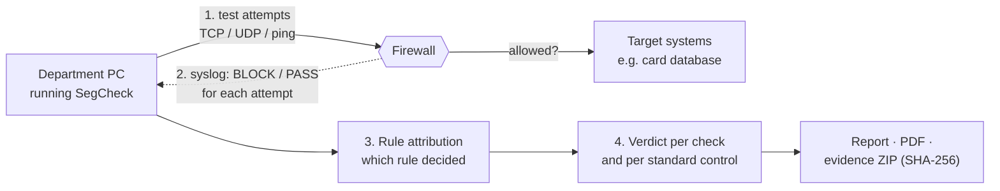

<p align="center"></p>

<h1 align="center">SegCheck</h1>

<p align="center"><b>Network segmentation testing with proof: does the network really keep sensitive systems apart?</b></p>

<p align="center">
  
  
  
  
  
</p>

SegCheck answers questions like *"can a PC in HR reach the card database?"* You run it **on a PC inside the
department you are testing**. It sends small, harmless connection attempts (TCP, UDP, ping) toward the
systems that department must **not** reach, compares every answer with the policy, checks the
**firewall's own log** of each attempt, names the **exact firewall rule** behind each result, and judges
the run against **PCI DSS, NIST SP 800-53, ISO/IEC 27002 and CIS v8**, control by control.

> SegCheck supports a PCI DSS segmentation test (Req. 11.4.5). It does not certify a company as compliant.
> Only test networks you own or have **written permission** to test.

---

## Contents

- [Why SegCheck](#why-segcheck)
- [How it works](#how-it-works)
- [Quick start](#quick-start)
- [Try it on a whole fake company (Docker lab)](#try-it-on-a-whole-fake-company-docker-lab)
- [The four steps of an audit](#the-four-steps-of-an-audit)
- [Reading the report](#reading-the-report)
- [Standards covered](#standards-covered)
- [Security design](#security-design)
- [Project layout](#project-layout)
- [Testing](#testing)
- [Limitations and roadmap](#limitations-and-roadmap)
- [Documentation](#documentation)
- [License](#license)

---

## Why SegCheck

Most scanners report "port closed" and stop there. Silence is not proof: the firewall may have blocked the
attempt, or the service may simply be switched off. SegCheck is built around that difference.

| | What it means in practice |
|---|---|
| **Silence is never a pass** | A reply on a forbidden path is a **failure**. No reply is only *not proven*, until the firewall's own log shows it blocked that exact attempt. Then it is **proven**. |
| **Firewall-log proof** | Reads the firewall's syslog (pfSense/OPNsense, Linux iptables/nftables, FortiGate, Cisco ASA/FTD, Sophos, MikroTik) and matches every attempt to a log line. A logged *pass* on a silent attempt is caught as a hole too. |
| **Names the guilty rule** | With an optional read-only rule export (pfSense `config.xml` or `iptables-save`), it replays the firewall's first-match logic: *"Let through by rule legacy-reporting (FORWARD rule 7)"*. |
| **Verdict per standard** | An offline compliance assistant (retrieval over its own control knowledge base, no AI model) gives *Met, proven*, *Not met* and similar results per control, with the fix and the evidence an assessor expects. Same run, same answer, every time. |
| **Patient, but honest** | Answers are final. A silent attempt is retried once with a longer wait that adapts to the network's real speed, so a lost packet cannot hide an open door. A run whose setup is broken stops early and says what to fix, rather than saving a misleading report. |
| **Tamper-evident evidence** | Saved reports cannot be edited (enforced in the database). Each audit exports a PDF and an evidence ZIP with a `MANIFEST.sha256`. |
| **Simple to run** | Double-click `SegCheck.exe`. No admin rights, and nothing listens on the network (the dashboard is `127.0.0.1` only). |

## How it works



1. **Test:** attempts leave from the PC you sit at and cross the real switches and firewall. SegCheck never
   relays them, so the real path is tested.
2. **Prove:** each attempt is matched to the firewall's log. A logged block turns "no answer" into proof.
3. **Explain:** the decisive firewall rule is named from the rule export or the log's rule label.
4. **Judge:** results are mapped to the controls of every chosen standard. The worst result for a control wins.

## Quick start

**Requirements:** Windows 10/11 (the launcher) or any OS with **Python 3.11+**. Internet is needed once, for
the first install of the Python packages.

```powershell
git clone <this repository's URL> SegCheck
```

Then **double-click `SegCheck.exe`** in the folder (or download the ZIP from GitHub, *Extract All…*, and
double-click it there). It does the rest:

- If Python 3.11+ is missing, it offers to install Python 3.12 for your user (no admin rights).
- The first start creates a private environment (`.venv`) and installs the packages, in about 2 minutes.
- The dashboard opens in your browser at `http://127.0.0.1:5000`. The first time, paste the **one-time
  setup token** shown in the black window, then create your account.

Without the exe, on any OS:

```powershell
python start_segcheck.py
```

Keep the black window open while you work. Closing it stops SegCheck; your work is already saved.

## Try it on a whole fake company (Docker lab)

[`lab/`](lab/README.md) builds **"PaySecure Ltd"**, a small payment company, in Docker Desktop. It has seven
department networks, five business systems, a **real Linux firewall** that logs every decision, and
SegCheck inside the network as the auditor's PC. The firewall contains **one planted mistake**, a forgotten
rule that lets staff PCs reach the card database:

```
legacy-reporting:  staff PCs (10.40.0.0/24)  →  card database 10.30.0.20 : 5432   ALLOWED (it should not be)
```

Double-click the buttons in `lab/`:

| Button | What it does |
|---|---|
| `Reset lab (fresh, with loophole).cmd` | Builds and starts everything fresh and opens SegCheck at `http://127.0.0.1:5091` |
| `Start lab (keep audits).cmd` | Starts the lab again and keeps your audits |
| `Firewall - fix loophole.cmd` / `Firewall - add loophole.cmd` | Removes or restores the planted rule |

**The demo story:** SegCheck finds the hole → names the exact firewall rule → the "network team" fixes it →
SegCheck proves the fix (*Compare two audits* shows it as **FIXED**).

## The four steps of an audit

Open **New audit**. Each step saves automatically and is ticked off as you finish it.

| Step | Question it answers | Example |
|---|---|---|
| **1 · Where you are** | Which network is this PC in? (detected for you) | Corporate staff LAN, this PC 10.40.0.100 |
| **2 · What to test** | Which networks and hosts must this department not reach? | Card systems 10.30.0.0/24: .10 and .20 |
| **3 · Firewall** | Is there a firewall, does it send logs, and can you load its rules? | Linux firewall, logs to this PC on UDP 5514 |
| **4 · Checks & launch** | Which standards, or your own rules / the client's access-matrix CSV? | PCI DSS CDE isolation, all probe groups |

Step 4 shows exactly what will be sent (every probe, port and target), the number of attempts and the
estimated time before you click **Launch audit**. Progress is shown live, and you can cancel at any time;
a cancelled run never saves a half report.

The full walkthrough, with every option and every error message, is in **[docs/USER_GUIDE.md](docs/USER_GUIDE.md)**.

## Reading the report

| Report verdict | Meaning |
|---|---|
| **FAILED** | At least one forbidden path is open: it answered, or the firewall logged it as passed. |
| **ATTENTION** | Nothing forbidden is open, but an approved business service is not working. |
| **PASSED** | Every forbidden path was blocked **and the firewall's log proves it**. |
| **NO HOLE FOUND** | Nothing forbidden answered, but it is not proven. Connect the firewall's logs and run again. |
| **COULD NOT TEST** | Nothing reached the network. The *Problems in this run* box says what to fix. |

Each rule card then shows what was sent, what came back on every port, the firewall's log entry, the rule
that decided it, **why**, and **what to do**. There is also a map of the run with a replay, a heatmap,
control results per standard, the compliance assistant's explanation, and a *Compare two audits* view
(fixed / regression / still failing).

## Standards covered

| Standard | Controls | Built-in test packs |
|---|---|---|
| **PCI DSS 4.0.1** | 1.3.1, 1.3.2, 1.4.2, 11.4.5 | CDE isolation from out-of-scope networks · Untrusted/DMZ networks to CDE · CDE outbound restriction |
| **NIST SP 800-53 Rev. 5** | SC-7, SC-7(5), AC-4 | Boundary protection between zones · Deny-by-default to sensitive zones |
| **ISO/IEC 27002:2022** | 8.22, 8.20 | Segregation of networks · Firewall management plane protection |
| **CIS Controls v8** | 12.2, 13.4 | Traffic filtering between segments |

Several standards can run together: each probe is sent once and counts for every standard that asks for it.
Packs that do not fit the current network are greyed out, with the reason. The control summaries are in
SegCheck's own words, with links to the official texts ([docs/FRAMEWORK_REFERENCES.md](docs/FRAMEWORK_REFERENCES.md)).

## Security design

- **Loopback only:** the dashboard binds to `127.0.0.1`. Firewall connectors only *listen* for syslog and
  read exports; SegCheck never logs in to or changes a device.
- **Explicit consent:** nothing is sent until you review the exact targets and click Launch. At most 400
  attempts per run, and a ping sweep runs only after its own tick box.
- **Web hardening:** scrypt password hashing, sign-in throttling, CSRF tokens on every form, a strict
  Content-Security-Policy (no inline scripts), and a one-time setup token for the first account.
- **Integrity:** reports are immutable (database triggers block edits), and evidence bundles carry SHA-256
  manifests. Deleting is explicit, and deleted data is removed from the database file.
- **Known limitation:** classic UDP syslog is unauthenticated. The report says so, and SegCheck accepts logs
  only from the firewall's learned address.

## Project layout

```
SegCheck.exe            Windows launcher: double-click to set up and start
start_segcheck.py       the same start-up on any OS
segcheck/               engine: probes (TCP/UDP/ICMP), policies, firewall-log evidence, storage
segcheck_web/           Flask web app
  routes/               pages (audit steps, assessments, dashboard, history)
  services/             the logic: audit_setup (the 4 steps), assessment_execution + patience (running),
                        firewall_connector + vendor_logs (log proof), rule_attribution (which rule),
                        compliance_assistant (verdict per standard), report_view / assessment_pdf (report)
  knowledge/            controls.json: the offline compliance knowledge base
  migrations/           database schema, upgraded automatically at start
  templates/, static/   HTML, CSS and JavaScript (no inline scripts)
lab/                    Docker lab "PaySecure Ltd" with a real firewall (see lab/README.md)
docs/                   user guide, hands-on labs, VirtualBox lab, verification, roadmap, references
scripts/                end-to-end tests, database upgrade, launcher source (C#) and icon
tests/                  automated test suite (tests/fixtures = test data)
```

## Testing

```powershell
python -m pytest -q
```

The regression suite has **607 passed** on Windows (17 Linux-only tests skipped) and **624 passed** on Linux,
run inside the lab's auditor container as a non-root user.

```powershell
python scripts/e2e_audit.py
```

```powershell
python scripts/e2e_office.py
```

`e2e_audit.py` starts a fresh, isolated SegCheck and drives the whole guided audit over HTTP. It needs two
private addresses on this PC, such as a VirtualBox adapter. `e2e_office.py` audits the Docker lab department
by department (start the lab first). Results and the manual acceptance tests are recorded in
[docs/VERIFICATION.md](docs/VERIFICATION.md).

## Limitations and roadmap

- SegCheck tests the paths you define, from the PC it runs on. Run it once per department.
- Without firewall logs, "no answer" stays *not proven*. That is by design.
- Approved business flows are not yet exempted from the broad NIST/ISO/CIS packs (use own rules or the
  access-matrix CSV for those). This is planned.
- `SegCheck.exe` is not code-signed, so Windows SmartScreen may warn (*More info → Run anyway*).

Planned: a combined report across departments, approved exceptions for standards, path trace for failed
rules, banner grabbing and re-audit reminders. See [docs/ROADMAP.md](docs/ROADMAP.md).

## Documentation

| Document | For |
|---|---|
| [docs/USER_GUIDE.md](docs/USER_GUIDE.md) | Every step and option, reading results, troubleshooting, removing SegCheck from a PC |
| [docs/HANDS_ON_GUIDE.md](docs/HANDS_ON_GUIDE.md) | Learn SegCheck through guided labs |
| [lab/README.md](lab/README.md) | The Docker office lab: networks, firewall, demo script |
| [docs/VIRTUALBOX_LAB.md](docs/VIRTUALBOX_LAB.md) | Manual test with VirtualBox VMs (Guest / pfSense / CDE) |
| [docs/VERIFICATION.md](docs/VERIFICATION.md) | What was tested and how |
| [docs/ROADMAP.md](docs/ROADMAP.md) | Done and future work |
| [docs/FRAMEWORK_REFERENCES.md](docs/FRAMEWORK_REFERENCES.md) | Standards mapping and official sources |

**Maintainers:** rebuild `SegCheck.exe` after changing `scripts/launcher/SegCheck.cs` with
`python scripts/build_launcher.py` (a test fails until you do). Upgrade a database by hand with
`python scripts/upgrade_local_database.py` (`--check` is read-only); the launcher normally does this itself.

## License

[MIT](LICENSE) © 2026 Moiz Siddiqui.
Use it only on networks you own or have written permission to test.
